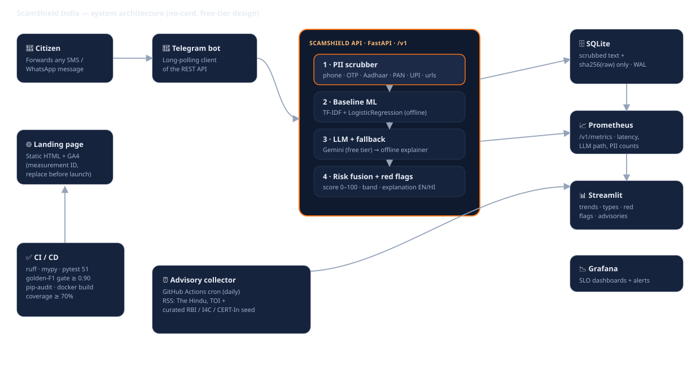

# Architecture

## Data flow (analyze)

1. **Client** — the Telegram bot (`bot/telegram_bot.py`, long-polling) or any HTTP client
   POSTs to `/v1/analyze`. The bot is deliberately thin: no model logic lives there.
2. **Validation & limits** — Pydantic schema (1–2000 chars), per-IP token bucket
   (429 on excess), security headers, request-id propagation. See ADR 0002.
3. **Scrub** — `scamshield/privacy.scrub_text()` masks phone/OTP/Aadhaar/PAN/card/UPI/email,
   reduces URLs to domain only, normalises zero-width chars. **Nothing downstream ever sees raw PII.**
4. **ML opinion** — TF-IDF (word 1–2 g, char 3–5 g) + LogisticRegression, multiclass over
   13 scam types + `safe`. Fully offline, ~3 ms.
5. **LLM opinion** — Gemini free tier if `GEMINI_API_KEY` is set (strict JSON contract +
   pydantic validation, prompt-injection hardened). Any failure/timeout/invalid output →
   deterministic `FallbackExplainer`. The request never fails because the LLM did.
6. **Fusion** — `risk.combine()`: ML probability + verdict confidence + red-flag weights.
   Critical flags (OTP/PIN request, digital arrest) impose a 68-point floor. Bands:
   0–24 Safe, 25–49 Medium, 50–74 High, 75+ Critical.
7. **Persist** — scrubbed text + sha256(raw) + labels/versions only. Raw message is
   never written. Structured JSON logs carry `analysis_id`, not message text.
8. **Observe** — counters/histograms at `/v1/metrics` (Prometheus), pre-built Grafana
   dashboard in `grafana/provisioning/`.

## Data flow (advisories)

GitHub Actions cron (`advisories.yml`, daily 09:00 IST) runs
`automation/fetch_advisories.py --online --seed-if-empty --out data/advisories.json`:
RSS from configured news sources (keyword-filtered) + a curated seed of real RBI/I4C/CERT-In/
DoT advisories (paraphrased, linked). Upserts by URL — no duplicates. Commits the JSON snapshot.

## Trust boundaries

| Boundary | Untrusted side | Trusted side | Control |
|---|---|---|---|
| Telegram → bot | User message | Bot | Length cap, bot-level try/catch |
| Bot → API | Network input | API | Schema validation, rate limit, size 2000 |
| API → LLM | Scrubbed text (still untrusted *content*) | LLM | Delimiters, "not instructions" system prompt, JSON contract, pydantic |
| API → DB | Scrubbed text | SQLite | Parameterized queries, WAL |
| RSS → collector | Arbitrary XML | Pipeline | defusedxml, fixed URL list, keyword filter, timeouts |
| Logs | Anything | Observability | JSON logger never receives raw message (service logs metadata only) |

## Deployment views

- **Local / dev**: `uvicorn` + SQLite + Streamlit (`make run`, `make dashboard`).
- **Docker Compose (demo)**: api + dashboard + prometheus + grafana (+ `demo` profile seeds synthetic history; `aws` profile runs LocalStack).
- **AWS (optional, real)**: Dockerfile as Lambda container behind HTTP API; Terraform in `infra/terraform` (LocalStack-tested). See `infra/README.md`.
- **Free hosts (optional)**: API → Cloudflare Workers/Containers; dashboard → Streamlit Community Cloud; DB → Supabase; static landing → GitHub Pages + GA4. Free-tier limits change — check before committing.

## Failure modes (and why they're safe)

| Failure | Behaviour |
|---|---|
| Model artifact missing | API degrades to fallback-explainer-only; `/v1/health` shows `model_loaded: false` |
| Gemini unset/errors/timeout | Automatic fallback to deterministic explainer; `scamshield_llm_calls_total{outcome="error"}` counts it |
| Storage down | Analysis still returns 200; write failure logged; `STORAGE_WRITES` stalls |
| Rate-limit breach | 429 + `Retry-After: 60` |
| Malicious/prompt-injection text | Scrubbed, delimited, parsed as data; on contract failure → fallback |
